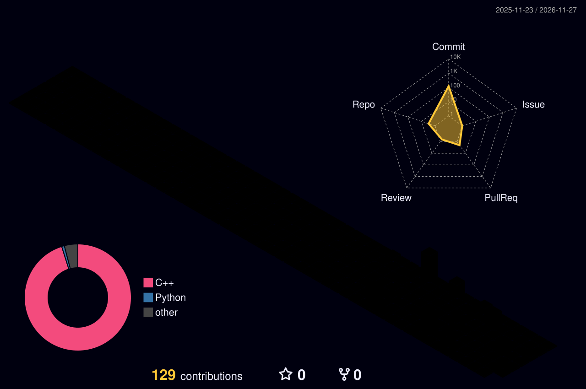

<div align="center">


<a href="https://github.com/kshitijsharma6107">
  
</a>

<br/>



<br/>


</div>

---

## `> ABOUT`

```bash
$ whoami
kshitijsharma6107

$ cat about.txt
B.Tech CSE student @ GZSCCET Bathinda (MRSPTU).

Interested in Artificial Intelligence, Machine Learning
and Data Structures & Algorithms.

Currently building AI-powered applications using Python,
LangChain, RAG and Docker.

Learning by building projects and solving problems.
```

> The monitor displays my latest commits; the shelf holds a book for every technology I'm learning.

---

## `> TERMINAL`

```bash
$ git log --oneline

docker_documentation-assistant: Build RAG application
docker_documentation-assistant: Add document processing
LEETCODE_SOLLNS: Solve DSA problems
LEETCODE_SOLLNS: Add C++ solutions

$ echo "Current mission"
Build. Learn. Debug. Repeat.
```

---

## `> PROJECTS`

<table>
  <tr>
    <td width="50%" valign="top">

      <a href="https://github.com/kshitijsharma6107/LEETCODE_SOLLNS">
        
      </a>

      **LeetCode Solutions**

      Collection of Data Structures and Algorithms problems solved using C++.

      
      
      

    </td>
    <td width="50%" valign="top">

      <a href="https://github.com/kshitijsharma6107/docker_documentation-assistant-">
        
      </a>

      **Docker Documentation Assistant**

      A Retrieval-Augmented Generation (RAG) application that allows users to ask questions about Docker documentation and retrieve relevant information from documents.

      
      
      
      
      

    </td>
  </tr>
</table>

---

## `> FOCUS`

<div align="center">


</div>

---

## `> TECH STACK`

<div align="center">


<br/><br/>


</div>

---

## `> STATS`

<div align="center">


<br/>


</div>

---


## `> ACTIVITY`

<div align="center">


</div>


---

## `> 3D CONTRIBUTIONS`

<div align="center">



<br/>


</div>

---

## `> CONNECT`

<div align="center">

<a href="https://github.com/kshitijsharma6107">

</a>

<a href="https://leetcode.com/u/kshitijsh612007/">

</a>

<a href="mailto:ks1422438@gmail.com">

</a>

<br/><br/>


<br/><br/>


</div>
